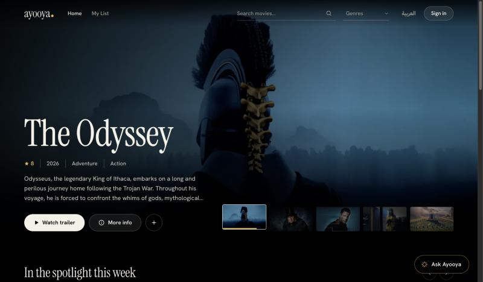
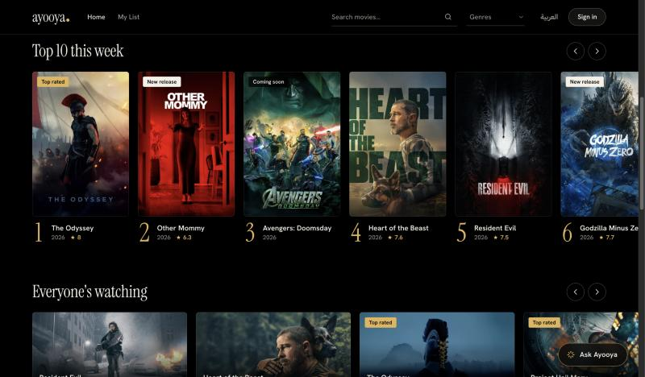

# Ayooya

**A film discovery app with an AI concierge, rebuilt security-first.**

**Live:** https://ayooya.ayaemx.workers.dev

Ayooya started in 2025 as a team project at ITI (a React movie browser).
In 2026 I rebuilt it on my own to show how my skills have grown: a real backend,
real authentication, an AI assistant with guardrails, a new visual identity, and
an automated test and delivery pipeline.

|                                           |                                           |
| ----------------------------------------- | ----------------------------------------- |
|         |  |
| Hero with background trailers             | Ranked Top 10 and data-driven labels      |
|       |                                           |
| Three-second intro with a generated sound |                                           |

## What it does

- **Browse** what's trending, popular, top rated and coming soon, in English or Arabic (full right-to-left layout).
- **Watch** trailers: the hero plays them silently in the background, with a sound toggle.
- **Ask Ayooya**, the AI concierge: "something like Interstellar but less sad", "a funny film for family night", or just "hi". It searches the real catalogue and explains each pick.
- **Save** films to My List. Guests keep their list on the device; signing in syncs it to the account.
- **Share** a film: every detail view has its own link.

## Before and after

|                  | v1 (2025, ITI team)                              | v2 (2026, solo rebuild)                                                             |
| ---------------- | ------------------------------------------------ | ----------------------------------------------------------------------------------- |
| **API key**      | Committed to the repo and visible in the browser | Server-side secret behind a Cloudflare Worker                                       |
| **Login**        | One hard-coded test account in client code       | Real accounts, hashed passwords, HttpOnly session cookies, rate limiting            |
| **My List**      | Lost on refresh                                  | Saved per device, synced to the account                                             |
| **Assistant**    | Keyword matching over the 20 films on screen     | An LLM plans a real catalogue search, with validation, guardrails and a fallback    |
| **Design**       | A single poster grid                             | Own design system: cinematic hero, filmstrip selector, ranked row, intro, RTL, a11y |
| **Quality**      | No tests, lint failing                           | 42 automated tests, lint with accessibility rules, CI on every push                 |
| **Dependencies** | 13 runtime packages with audit warnings          | 9 runtime packages, production audit clean, Dependabot                              |
| **Product**      | No measurement                                   | Cookieless analytics and an A/B test on the hero                                    |

v1 is preserved under the [`v1-iti`](../../tree/v1-iti) tag.

## How it is built

```
Browser (React SPA)
   │  same-origin HTTPS, HttpOnly session cookie
   ▼
Cloudflare Worker ──► TMDB API       key stored as a Worker secret
   │              ──► Workers AI     LLM with no secrets and no tools
   └─────────────►  D1 (SQLite)     users, sessions, lists, counters
```

**Frontend:** React 19, Redux Toolkit and RTK Query, React Router, i18next, Vite. No UI library; the design system is hand-written CSS using logical properties so the layout mirrors for Arabic.

**Backend:** one Cloudflare Worker that serves the app and the API from the same origin, a D1 database, and Workers AI.

**Tooling:** Vitest, Testing Library, Miniflare (runs the real Worker in tests), ESLint with jsx-a11y, Prettier, GitHub Actions, Dependabot.

## Security

The full threat model is in [SECURITY.md](SECURITY.md). The short version:

- **Secrets stay on the server.** The browser only ever calls `/api/*`; CI fails if a key pattern appears in the client bundle.
- **Authentication:** PBKDF2-SHA256 with per-user salts, random session tokens stored only as hashes, `__Host-` cookies that are `HttpOnly`, `Secure` and `SameSite=Lax`.
- **Abuse resistance:** rate limits per IP and per targeted account, identical errors for wrong password and unknown email, CSRF checks on every state change.
- **Strict Content-Security-Policy:** no inline scripts or styles, self-hosted fonts, frames only from the trailer host.
- **Input allow-lists:** the Worker exposes a fixed set of catalogue endpoints and validates every parameter.

### How the assistant is kept safe

The model never receives a secret and has no tools. It returns a small JSON plan
(intent, genres, years); the Worker validates that plan against allow-lists and
runs the catalogue query itself. A second call asks the model to explain picks
from the films that were actually found, and any film id that was not in that
list is dropped, so it cannot invent titles. If the model is unavailable, a
keyword planner answers instead. These behaviours are covered by tests that feed
the Worker a deliberately hijacked model response.

## Product thinking

- **Analytics without tracking:** an allow-list of event names counted per day. No cookies, user ids or IP addresses are stored, and Do Not Track is honoured.
- **A/B test:** half of visitors see "Watch trailer" as the main hero button, half see "Find my next movie". Click-through per variant is available to the owner at `GET /api/stats`.
- **Labels from real data:** "New release", "Coming soon" and "Top rated" are computed from release dates and scores, never assigned by hand.
- **Accessibility:** keyboard navigation, visible focus, screen-reader labels, reduced-motion support, and a native `<dialog>` for film details.

## Run it locally

```bash
npm install

# Option A: no accounts or keys (canned films, scripted assistant)
npm run dev:mock        # terminal 1: mock API on :8787
npm run dev             # terminal 2: app on http://localhost:5173

# Option B: real data
cp .dev.vars.example .dev.vars      # add your TMDB key
npm run db:migrate:local
npm run dev:api         # terminal 1 (needs `npx wrangler login`)
npm run dev             # terminal 2
```

`npm run check` runs lint, all tests and the production build.

## Deploy

```bash
npx wrangler login
npx wrangler d1 create ayooya            # put the printed id in wrangler.jsonc
npm run db:migrate
npm run deploy
npx wrangler secret put TMDB_API_KEY
npx wrangler secret put ADMIN_TOKEN      # any long random string
```

## Project layout

```
worker/        API routes (auth, favorites, movies, chat, events) and libraries
migrations/    D1 schema
src/           React app: api, app, features, components, pages, locales
test/          API integration tests, assistant unit tests, UI tests
scripts/       Offline mock API
```

## Known limitations

- No email verification, password reset or multi-factor authentication yet.
- The assistant's film knowledge comes from an open model; it can be wrong about trivia, and it says so when unsure.
- Background trailers are desktop only.

## Credits

v1 was built with my ITI teammates. Film data and images come from
[TMDB](https://www.themoviedb.org/); this product uses the TMDB API but is not
endorsed or certified by TMDB.

Built by [Aya Emad](https://github.com/ayaemx).
