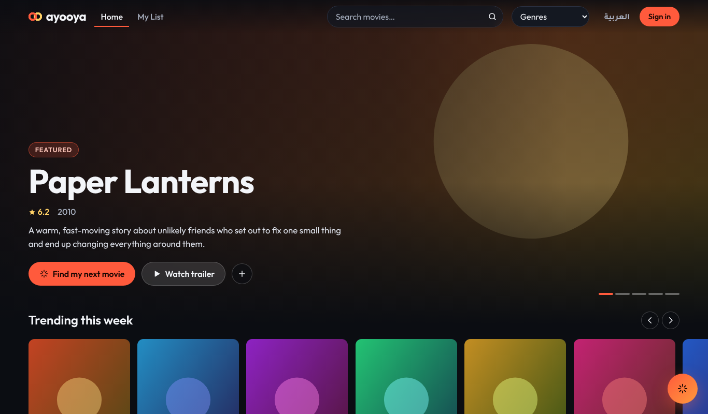
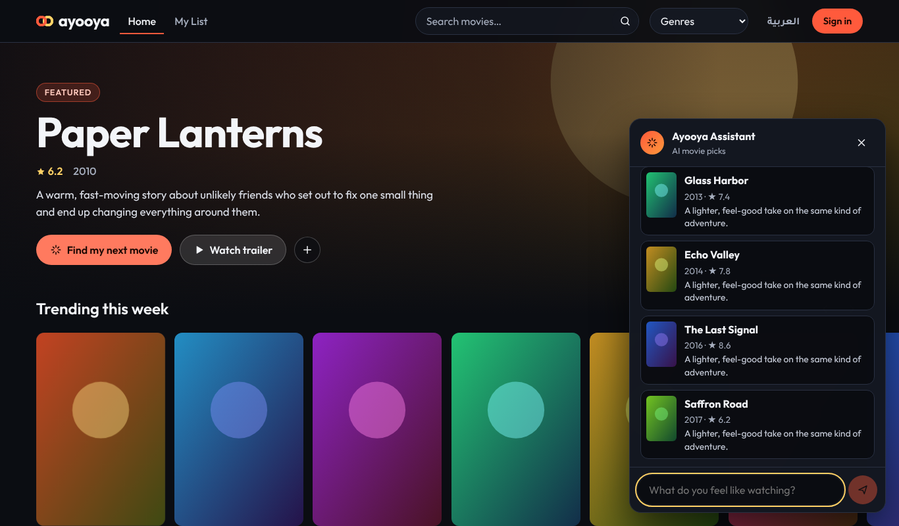
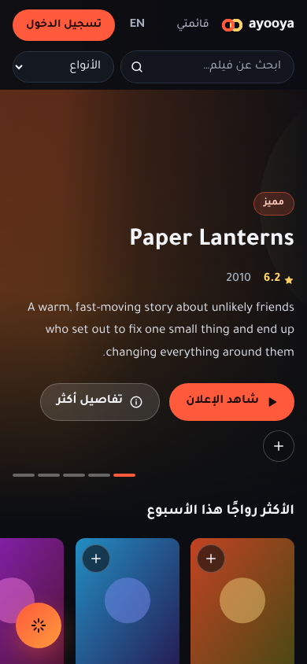

# Ayooya — movie discovery with an AI assistant

A streaming-style movie discovery app: trending billboard, scrolling rows,
trailers, a personal watchlist, English/Arabic (RTL) and an AI assistant that
understands requests like _"something like Interstellar but less sad"_.

- **v1 (2025, ITI team project):** https://ayaemx.github.io/ayooya-movie-app/ — kept online as the "before", tagged [`v1-iti`](../../tree/v1-iti)
- **v2 (2026, this branch):** a security-first rebuild by [Aya Emad](https://github.com/ayaemx)

| Home                                  | AI assistant                                    | Arabic, mobile                                          |
| ------------------------------------- | ----------------------------------------------- | ------------------------------------------------------- |
|  |  |  |

<sub>Screenshots use the offline mock catalogue (`npm run dev:mock`), so posters are placeholders.</sub>

## Before → after

| Area             | v1                                                    | v2                                                                                                                               |
| ---------------- | ----------------------------------------------------- | -------------------------------------------------------------------------------------------------------------------------------- |
| **API key**      | Committed in `.env`, visible in the browser bundle    | Server-side secret behind a Cloudflare Worker proxy                                                                              |
| **Login**        | Hard-coded test account in client code                | Real accounts, hashed passwords, HttpOnly session cookies, rate limiting                                                         |
| **Watchlist**    | Lost on refresh                                       | Saved per device for guests, synced to the account after sign-in                                                                 |
| **Chatbot**      | Keyword matching over the 20 movies on screen         | LLM plans a real catalogue search, explains each pick, with guardrails and a fallback                                            |
| **UI/UX**        | Single grid, mouse-only hover actions, partial Arabic | Billboard + rows, skeleton loading, shareable detail links, full RTL, keyboard and screen-reader support, reduced-motion support |
| **Quality**      | 0 tests, ESLint failing                               | 32 automated tests, lint with accessibility rules, CI on every push                                                              |
| **Dependencies** | 13 runtime packages, audit warnings                   | 9 runtime packages, `npm audit --omit=dev` clean, Dependabot                                                                     |
| **Product**      | No measurement                                        | Privacy-friendly analytics, hero A/B test, SEO and share cards                                                                   |

## What each part demonstrates

**Security** — see [SECURITY.md](SECURITY.md) for the full threat model.
Backend-for-frontend proxy, PBKDF2 password hashing, `__Host-` session cookies,
CSRF and rate-limit defences, strict Content-Security-Policy, input allow-lists,
and LLM guardrails mapped to the OWASP LLM Top 10.

**AI** — `worker/lib/assistant.js`. The model never gets tools or secrets. It
returns a small JSON plan (intent, genres, years); the Worker validates it and
runs the TMDB query itself, then asks the model to justify picks from the
results. Invented movies are impossible by construction.

**UI/UX** — `src/components`, `src/index.css`. Own design system (no UI
library), logical CSS properties so the layout mirrors for Arabic, native
`<dialog>` for accessible modals, self-hosted fonts.

**Automation** — `.github/workflows/ci.yml`. Lint, tests, build, dependency
audit, secret scan and a Worker dry-run on every push; optional auto-deploy.

**Business** — `worker/routes/events.js`. Cookieless event counts and a 50/50
hero experiment ("Watch trailer" vs "Find my next movie") with click-through
per variant at `GET /api/stats`.

## Tech stack

React 19 · Redux Toolkit + RTK Query · React Router · i18next · Vite ·
Cloudflare Workers (API + static hosting) · D1 (SQLite) · Workers AI · Vitest ·
Testing Library · Miniflare · GitHub Actions

## Run it locally

```bash
npm install

# Option A — no accounts or keys needed (canned movies, scripted AI)
npm run dev:mock        # terminal 1: mock API on :8787
npm run dev             # terminal 2: app on http://localhost:5173

# Option B — real data
cp .dev.vars.example .dev.vars      # add your TMDB key
npm run db:migrate:local
npm run dev:api         # terminal 1 (needs `npx wrangler login` for the AI model)
npm run dev             # terminal 2
```

`npm run check` runs lint, tests and the production build.

## Deploy (free Cloudflare plan)

```bash
npx wrangler login
npx wrangler d1 create ayooya            # paste the printed database_id into wrangler.jsonc
npm run db:migrate
npx wrangler secret put TMDB_API_KEY     # a NEW key — see the note below
npx wrangler secret put ADMIN_TOKEN      # any long random string
npm run deploy
```

> **Rotate the TMDB key first.** The v1 key was committed to this public repo, so
> it must be treated as leaked. Create a new key in TMDB settings and use only
> the new one here.

To see the A/B results:
`curl -H "Authorization: Bearer <ADMIN_TOKEN>" https://<your-app>/api/stats`

## Project layout

```
worker/        API: routes (auth, favorites, movies, chat, events) + lib (crypto, sessions, rate limit, TMDB, assistant)
migrations/    D1 schema
src/           React app (api, app, features, components, pages, locales)
test/          API integration tests (Miniflare), assistant unit tests, UI tests
scripts/       Offline mock API
```

## Credits

v1 was built with the ITI team. Movie data and images come from
[TMDB](https://www.themoviedb.org/); this product uses the TMDB API but is not
endorsed or certified by TMDB.
